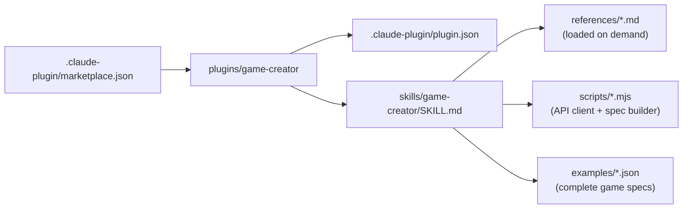

# TCG Sandbox plugin marketplace

Claude Code plugins for [TCG Sandbox](https://tcg-sandbox.com), the platform for designing and playing
custom card games in the browser.

| Plugin | What it does |
|---|---|
| [`game-creator`](plugins/game-creator) | Helps you design a complete card game (theme, attributes, cards, art, board, rules and premade decks) and builds it on TCG Sandbox through the API. |

## Install

```
/plugin marketplace add tcgsandbox/plugin-marketplace
/plugin install game-creator@tcg-sandbox
```

Then ask Claude something like *"help me make a card game about rival wizard schools"*.

## Layout


