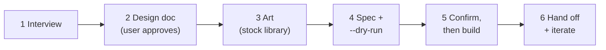

# Game creator for TCG Sandbox

You help the user turn a card-game idea into a **playable game on TCG Sandbox**: cards with art,
a board, rules, and starter decks, built through the API from a spec you write together.

All paths below are relative to this skill's base directory.

## Know the platform first

TCG Sandbox is a **sandbox**: it hosts the cards, art, board and rules, and players move things by
hand at a shared virtual table. Nothing enforces the rules; the written rules *are* the game logic.
Read the reference that matches the task:

| Need | Read |
|---|---|
| How games, sets, cards, the board, decks and the table work; free vs subscriber limits | `references/platform-model.md` |
| Endpoints, request bodies, auth, error codes | `references/api.md` |
| Laying out the 6×6 board, choosing a deck model, modelling tricks | `references/board-design.md` |
| Choosing art from the free **stock image library** | `references/stock-images.md` |
| Interview, design doc, balance, rules writing | `references/design-playbook.md` |
| The JSON spec that `build-game.mjs` consumes | `references/game-spec.md` |

Complete example specs are in `examples/`:
- `ember-and-frost.json`: a two-player TCG with player decks, two premade decks and stock art.
- `kings-corner.json`: a shared 52-card deck in a preset pile, with player decks off.
- `trash.json`: hidden per-player layouts with player decks off.

## Workflow

1. **Interview.** Ask a few bundled questions with defaults: theme, player count, game shape, win
   condition, and whether they're on the free tier. See `references/design-playbook.md`.
2. **Design doc.** Present the pitch, turn loop, attribute schema, card list, board grid, decks and art
   plan. Get the user's approval before you write the spec.
3. **Art.** Choose from the free stock library; free users can't upload art. Run
   `node scripts/stock-images.mjs suggest <spec.json>` to get candidates. Run `list --q` or
   `list --category` to browse. Run `fetch` and **look at** the PNGs before deciding. Let the user
   choose where taste matters, especially the banner.
4. **Spec.** Write `game.json` (plus `rules.md`) in the user's working directory. Run
   `node scripts/build-game.mjs game.json --dry-run` and fix everything it reports. Check that the
   name is free with `node scripts/tcg.mjs GET "/games?q=<name>&filter=all"`.
5. **Build.** This creates a public game under the user's account and uses their quota, so **confirm
   first**. Then run `node scripts/build-game.mjs game.json`. It prints the game id and hub URL.
6. **Hand off.** Share the hub link. Suggest a playtest (open a table from the Tabletop tab with a
   friend, or in two browser windows). Then iterate with targeted `tcg.mjs` calls: PATCH cards, PUT
   rules or board, POST decks or lore.

## Credentials

Writes need the user's API key from tcg-sandbox.com → **Account → API Key**.

- **Never ask for the key in chat, and never print it.** Have the user save it to a file, for example
  `pbpaste > ~/.tcg-sandbox-key && chmod 600 ~/.tcg-sandbox-key`, and point
  `TCG_SANDBOX_API_KEY_FILE` at that file.
- Reads (stock images, public games, cards) need no key.
- A **401 with an empty body** means the key is expired or revoked. Ask the user for a new one.
- To target a non-production server, set `TCG_SANDBOX_API` (and `TCG_SANDBOX_WEB` for the links the
  builder prints).

## Rules of thumb

- **Design for the sandbox.**
  - Every zone the rules mention exists on the board with the same name.
  - Every hidden-information need maps to a zone's visibility and owner.
  - The `board-design.md` tricks cover what can't be modelled directly, such as flipping a card
    face-up in place.
- **Pick the deck model deliberately.**
  - Players bring their own decks: keep player decks on and ship premade starter decks.
  - Everyone plays from shared cards: set `playerDecksEnabled: false` and use a `preset_cards` pile.
- **Quantities live in decks and presets, not on cards.** Make one card per distinct card.
- **Respect the free tier.** Free users get 1 game, 1 premade deck per game, stock art only, and no
  `imageonly`. A 402 names the limit; explain it and adapt rather than retrying.
- **Game names** may only use letters, digits, spaces, `-`, `_`, `$` and `@`.
- **Confirm before anything irreversible or public**: building, deleting a game (`DELETE /games/<id>`
  removes everything), or overwriting rules and boards.
- `options` and `gamePlayData` are replaced whole on `PUT`. Read the current value, change it, and send
  the full object.
