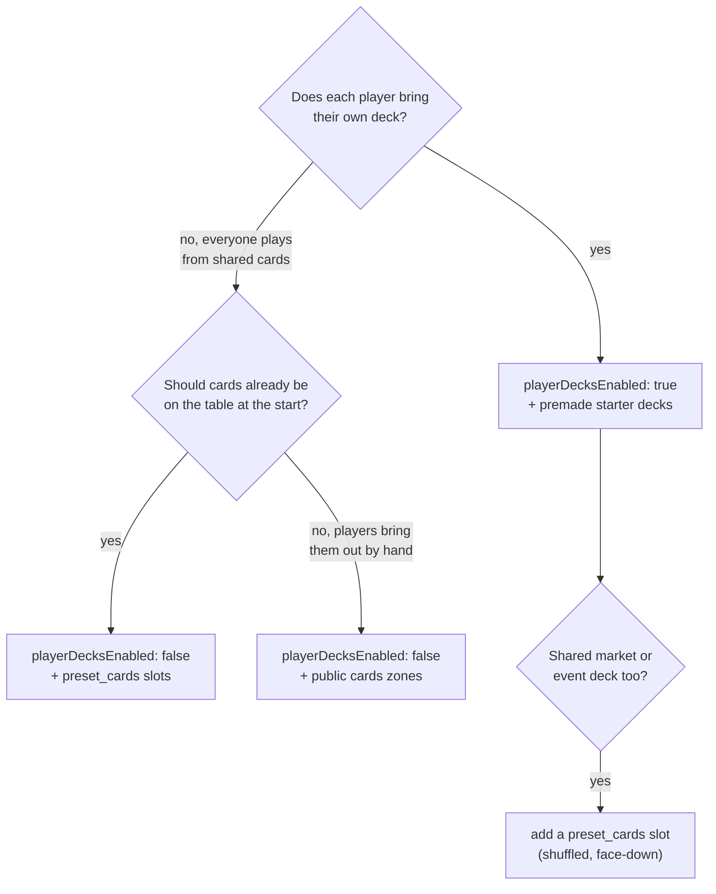

# Designing the board

The board is a 6 × 6 grid. Zones (slots) are rectangles on it. Good boards are built around what players
actually **do** on a turn: one zone for each place a card can live, sized to how many cards gather
there.

## Checklist

1. **List the zones the rules mention**: battlefield, graveyard, mana row, shared market, draw pile and
   so on. Every zone named in the rules must exist on the board with **exactly that name**. The rules
   are shown under a picture of the board.
2. **Decide who owns each zone.** Per-player zones get `playerOwner: 1..N`. Shared zones get `null`.
3. **Decide what's hidden.**
   - `public`: everyone sees it.
   - `private` + owner: only that player sees it, for a hidden reserve or a face-down "set" card.
   - `private` + no owner: nobody sees it, for a face-down stack or a shared draw pile.
4. **Choose a type.**
   - `cards` for zones players fill by hand.
   - `counters` for life, mana and score (counters start at 0; players adjust them with +/−).
   - `preset_cards` for a pile that should already be on the table when play starts.
5. **Size it.** Width and height decide how many cards show without scrolling; a 1×1 cell shows about
   one card. `maxCount` caps how many stacks a zone takes.
6. **Mirror player areas.** Put player 1 at the top and player 2 at the bottom with the same shapes, and
   shared zones in the middle rows. Players read a mirrored board instantly.
7. **Don't build a hand.** Every player already has a private hand. Don't make a "Hand" zone unless the
   game needs a second, separate hand.
8. **Don't build a deck zone for player decks.** When `playerDecksEnabled` is true, each player's deck
   lives in the toolbar's Deck window. Only use a `preset_cards` draw pile for **shared** decks, usually
   with player decks turned off.

## Picking the deck model

`preset_cards` modes:
- `shuffled`: the standard shuffled deck.
- `ordered`: a fixed setup, like a scripted tutorial, a stacked event deck, or a known starting row.
- `random` with a `count`: draws with repeats from a pool, for loot tables and random encounters.

`topCardVisible: true` on a private pile makes a face-up discard or market pile where only the top
shows.

## Proven layouts

### Two-player duel (decks on)
Ember and Frost uses this layout (`examples/ember-and-frost.json`). P1 means `playerOwner: 1`.

| col → | 0 | 1 | 2 | 3 | 4 | 5 |
|---|---|---|---|---|---|---|
| **row 0** | P1 Life *(counter)* | P1 Support | P1 Support | P1 Support | P1 Energy *(counter)* | P1 Graveyard |
| **row 1** | P1 Battlefield | ← | ← | ← | ← | ← |
| **row 2** | · | Stack *(shared)* | ← | ← | ← | · |
| **row 3** | · | ↑ | ↑ | ↑ | ↑ | · |
| **row 4** | P2 Battlefield | ← | ← | ← | ← | ← |
| **row 5** | P2 Life | P2 Support | ← | ← | P2 Energy | P2 Graveyard |

### Shared deck, 2–4 players (decks off)
This is Kings Corner (`examples/kings-corner.json`). Each zone is 2×2. The Draw pile is a private
`preset_cards` slot (shuffled, all 52 cards); every other zone is a public `cards` zone.

| | cols 0–1 | cols 2–3 | cols 4–5 |
|---|---|---|---|
| **rows 0–1** | Corner | North | Corner |
| **rows 2–3** | West | **Draw pile** | East |
| **rows 4–5** | Corner | South | Corner |

### Hidden per-player layout (decks off)
This is Trash (`examples/trash.json`).
- Each player has ten public 1×1 spots (A–10), owned so they show the player's colour.
- Each player also has a private, **owner-less** "face-down" stack that even its owner can't see.
- The middle rows hold the Draw pile and a public Discard pile.

### Four-player free-for-all (decks on)
- Give each player a 3×3 quadrant holding a Battlefield (3×2) plus a one-row strip for Life (counter)
  and Graveyard.
- Leave no shared zone, or carve a 2×2 shared zone out of the centre by shrinking the quadrants'
  inner edges.

## Modelling tricks (the sandbox has no flip action)

- **Face-down card in a fixed spot that's later revealed**: this can't be modelled directly.
  - If the card's identity is unknown to everyone anyway, put all such cards in one hidden owner-less
    stack and let a player take *any* card when the rules say "reveal the card at spot N". It plays
    the same.
  - If the card must stay hidden *and* stay put, use a private zone owned by that player (only they
    see it), and have the rules say when to move it to a public zone.
- **Face-down to the owner, visible to everyone else** (Hanabi-style): not supported. Choose different
  hidden information.
- **Tapping, exhausting or status effects**: attach counters to a card stack, or create a 1×1
  "Exhausted" zone per player.
- **Turn tracker, round counter or score track**: use a shared `counters` zone with `maxCount` set to
  the number of tracks.
- **Market or row of face-up cards to buy from**: a `preset_cards` deck (private, shuffled) next to a
  public `cards` zone of width N. The rules tell players to refill the row from the deck.

## Sanity checks before saving
- Every zone fits the grid and nothing overlaps. `build-game.mjs --dry-run` checks this.
- Owned zones only use player numbers up to `playerCount`.
- Every zone the rules mention exists with the same name, and every zone on the board is used by the
  rules.
- A shared draw pile with decks on is only right when there really are two decks: player decks plus a
  shared market or event deck.
