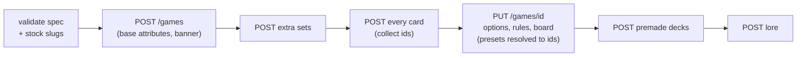

# Game spec format (`build-game.mjs`)

One JSON file describes a whole game. `scripts/build-game.mjs` validates it, then creates everything in
dependency order:



```bash
node scripts/build-game.mjs game.json --dry-run   # validate only; no writes
node scripts/build-game.mjs game.json             # build; prints the id and hub URL
```

File paths in the spec (rules, lore, images) are relative to the spec file. The builder **creates**
games; it doesn't update them. To change a built game, use `tcg.mjs` calls (see `api.md`). If a build
fails partway, the builder prints the new game's id. Fix the spec, delete that game (with the user's
OK), and rerun.

## Shape

```jsonc
{
  "name": "Ember and Frost",           // unique; letters, digits, spaces, - _ $ @ only
  "description": "One or two sentences for the browse list.",
  "banner": { "stockSlug": "dungeon-01" },   // or { "file": "art/banner.png" } (subscriber)
  "bannerVerticalAlignment": 50,              // 0-100, optional
  "options": {                                // optional; the defaults are shown
    "cardDisplayMode": "managed",             // or "imageonly" (subscriber to newly select)
    "cardDisplayContext": "everywhere",       // or "ingameonly"
    "playerDecksEnabled": true                // false = no decks of either kind
  },
  "sets": [
    {
      "id": "base",                           // the first set must be "base"
      "attributes": { "cost": "number", "type": "string", "flying": "boolean" },
      "cards": [
        {
          "name": "Ember Imp",                 // unique within the set
          "description": "Rules text or flavour.",
          "attributes": { "cost": 1, "type": "Creature", "flying": false },  // types must match
          "image": { "stockSlug": "goblin" }   // or { "file": "art/imp.png" } (subscriber), or omit
        }
      ]
    },
    { "id": "frostfall", "displayName": "Frostfall", "description": "First expansion",
      "attributes": { "cost": "number" }, "cards": [ ] }
  ],
  "rules": { "file": "rules.md" },            // or an inline Markdown string
  "designNotes": "Private notes.",            // optional
  "board": {
    "playerCount": 2,                         // 1-4
    "slots": [
      // defaults: width 1, height 1, type "cards", visibility "public", playerOwner null,
      //           maxCount 10 (cards) / 5 (counters) / 1 (preset_cards)
      { "name": "Battlefield", "row": 1, "column": 0, "width": 6, "maxCount": 6, "playerOwner": 1 },
      { "name": "Life", "row": 0, "column": 0, "type": "counters", "maxCount": 1, "playerOwner": 1 },
      { "name": "Draw pile", "row": 2, "column": 2, "width": 2, "height": 2,
        "type": "preset_cards", "visibility": "private",
        "presetCards": {
          "mode": "shuffled",                 // ordered | shuffled | random
          "cards": [ { "set": "base" } ],     // card references; see below
          "count": 10,                        // required for random only
          "topCardVisible": false
        } }
    ]
  },
  "premadeDecks": [                           // not allowed when playerDecksEnabled is false
    { "displayName": "Ember Starter", "description": "Go wide early.",
      "cards": [ { "card": "Ember Imp", "quantity": 4 } ] }
  ],
  "lore": [ { "title": "The Long Winter", "content": { "file": "lore/winter.md" } } ]
}
```

## Card references

These are used in `presetCards.cards` and `premadeDecks[].cards`:

| Reference | Means |
|---|---|
| `{ "card": "Ember Imp", "quantity": 3 }` | 3 copies of that card. `quantity` defaults to 1. |
| `{ "card": "Ember Imp", "set": "frostfall" }` | Pick the set when the name appears in more than one. |
| `{ "set": "base", "quantity": 4 }` | One entry per card in the set, each with that quantity: "4 of everything". |

## What validation catches
- Game names with disallowed characters.
- The first set not being `base`, and bad set ids.
- Duplicate card names in a set.
- Undeclared or wrongly typed card attributes.
- Slots off the 6×6 grid, overlapping slots, and owners above `playerCount`.
- Missing preset contents, `random` without a `count`, and piles over 500 cards.
- Premade decks in a game with decks off.
- References to cards or sets that don't exist.
- Stock slugs missing from the live catalog.

It **can't** catch a name that's already taken (the server returns 409) or quota limits (402). Check the
name first with `GET /games?q=<name>&filter=all`.
