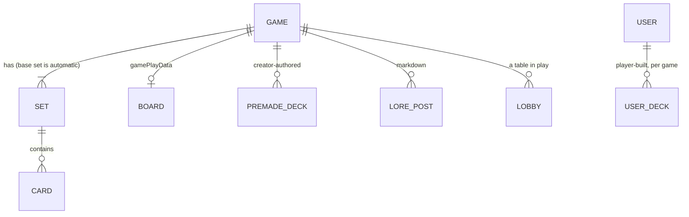

# How TCG Sandbox works

TCG Sandbox (tcg-sandbox.com) is a **sandbox**, not a rules engine. It hosts a card game's content
(cards, art, a board, written rules) and gives players a shared virtual table to play on. Players move
cards and counters by hand, the way they would at a physical table. Nothing enforces turn order, costs
or win conditions. **The rules text is the game's logic**, so it has to be clear enough for people to
follow.

## Game

- **`name`**: unique across the site. Only letters, digits, spaces, `-`, `_`, `$` and `@` are
  allowed. No `&`, apostrophes, colons or parentheses. Pick the name early and check that it's free with
  `GET /games?q=<name>&filter=all`.
- **`description`**: one or two sentences, shown on the game's card in the browse list.
- **Banner**: a wide image across the top of the game hub. It's either a stock banner (`bannerStockSlug`)
  or an uploaded image (a subscriber feature). The frame shows about a 6:1 crop of a 5:1 image, and
  `bannerVerticalAlignment` (0–100, default 50) picks which horizontal band shows.
- **`rules`**: Markdown, shown in the hub's "Rules & Game Board" tab and in the in-game Rules window,
  always under a thumbnail of the board. Refer to zones by the exact names used on the board.
- **`designNotes`**: private notes for the designer (up to 16,384 characters).
- **`options`**:
  - `cardDisplayMode`: `managed` (the default) renders a framed card with name, attributes, description
    and art. `imageonly` renders the bare art, which suits cards whose art already shows everything,
    like real playing cards. **Newly selecting `imageonly` needs a subscription.**
  - `cardDisplayContext`: `everywhere` (default) or `ingameonly`, which controls where the display mode
    applies.
  - `playerDecksEnabled` (default true): see **Decks** below.
- **`playable`**: computed by the server. True once a board is saved **and** the game has at least one
  card. Only playable games appear in the public list and can open lobbies.

## Sets, attributes and cards

- Every game gets a **base set** (id `base`) when it's created. Its attribute schema comes from the
  game-create request's `attributes`. More sets (expansions, tokens, alternate art) are optional.
- **Attributes** are a per-set schema of `name → string | number | boolean`. Every card in the set gives
  values for them. Use them for anything the rules read: cost, type, power, rarity, faction, keywords.
  Attributes can be **added** to an existing set later but never renamed or removed, so design them
  carefully up front.
- **Cards** have a name, an optional description (rules text or flavour), attribute values, and an
  image:
  - `cardStockSlug`: free art from the curated stock library (`GET /images/stock?kind=cards`).
  - `cardImage`: an uploaded data URL. **Needs a subscription.**
  - No image: the shared card-back art.
- **Card quantities live in decks, not on cards.** A game has one card per distinct card. "Four of
  each" is expressed in a deck, or in a preset slot's quantities.

## The board

The board is a fixed **6 × 6 grid** of **slots** (zones). Each slot has:

| Field | Meaning |
|---|---|
| `row`, `column` | Top-left cell, 0-based. |
| `width`, `height` | Span in cells. It must fit: `row + height ≤ 6` and `column + width ≤ 6`. Slots must not overlap. Gaps are fine. |
| `type` | `cards`: holds cards. `counters`: holds numeric counters (life, mana, score). `preset_cards`: a pile of cards dealt automatically when a table opens. |
| `maxCount` | Capacity: how many card stacks or counters it holds. A counters slot starts with that many counters at 0. A preset pile ignores it. |
| `visibility` | `public`: everyone sees the cards. `private`: only the owner sees them; others see card backs. |
| `playerOwner` | `1`–`4`, or `null` for shared. Owned zones are tinted in that seat's colour. |
| `name` | Label shown on the zone, at most 32 characters. Always name zones. |
| `presetCards` | Only on `preset_cards` slots; see below. |

`playerCount` (1–4) is how many seats the table has.

**Private and unowned (`playerOwner: null`) means hidden from everyone**, including whoever put the cards
there. Use this for face-down stacks.

### Preset card slots

A `preset_cards` slot is filled once, when a table (lobby) is created, from the slot's `presetCards`:

- `mode`:
  - `ordered`: the listed cards in order, the first one on top.
  - `shuffled`: the same cards, shuffled.
  - `random`: `count` cards drawn at random, with repeats, from the listed pool.
- `cards`: `{ cardId, setId, quantity }` entries.
- `count`: only used by, and required for, `random`.
- `topCardVisible`: for a private pile, whether the top card is face-up. That makes a face-up discard
  pile versus a face-down draw pile. A public pile is always visible.

On the table a preset slot is a **pile**: it shows its top card and a count. Only the top card can be
taken, and anything dropped on it goes on top. A pile deals at most 500 cards. Every table gets its own
freshly dealt copy.

## Decks

There are two kinds of deck. Each is a list of `{ cardId, setId, quantity }`.

- **User decks**: built by each player for themselves in the hub's Decks tab.
- **Premade decks**: built by the game's creator and offered to every player. Use them so new players
  can sit down and play without deckbuilding first.

At the table, the deck a player picks is their private draw pile ("library"). They draw from it, search
it, and shuffle cards back into it from the toolbar's Deck window.

**`playerDecksEnabled: false`** removes decks completely. There's no deck picker, Deck tool or Decks
tab, and deck writes are refused. Use it for games played from shared cards on the board, such as a
standard 52-card deck in a `preset_cards` slot.

## The table (lobby)

- A host opens a table from the game's **Tabletop** page and shares an invite link. Up to
  `playerCount` players join.
- **Every player has a private hand.**
- A toolbar holds:
  - Players
  - Chat
  - Deck (when decks are on)
  - Rules
  - Card preview
  - Dice roller (any number and size of dice)
- Players drag cards between their hand, slots and stacks. Dropping a card onto another card makes a
  stack. Counters have +/− controls, and counters can also be attached to card stacks (damage, +1/+1).
- **Nothing is enforced** except what the board structure itself implies: capacity, the visibility of
  private zones, and pile order.

## Free tier and subscription

| | Free (`basic`) | Subscriber ($5/month) |
|---|---|---|
| Games you own | 1 | unlimited |
| Premade decks per game | 1 | unlimited |
| Your own decks per game | 1 | unlimited |
| Lore posts per game | 5 | unlimited |
| Upload card or banner art | no (stock art only) | yes |
| Switch a game to `imageonly` | no | yes |
| In-app AI design assistant | no | yes |
| Create an API key (needed to build with this skill) | no | yes |

Building needs an API key, so the user is normally a subscriber. The free column still matters for a
key that outlived a cancelled subscription: it keeps working until it expires, under free limits.

A request over a limit returns **402** with a body naming the quota or feature. When that happens, tell
the user plainly what limit they hit and what the alternative is. Don't retry.
